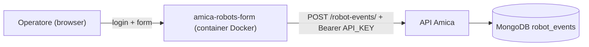

# Amica Robot Events – Form di invio log

Web app protetta da login che permette di comporre, tramite un **form modulare**, gli eventi dei robot
(dialoghi, quiz, questionari, domande/risposte AI) e di inviarli all'endpoint Amica
`POST /robot-events/`, che li salva nella collection MongoDB `robot_events`.



L'API key **non arriva mai al browser**: il server fa da proxy, valida il corpo della richiesta e la inoltra.

## Funzionalità

- **Login** con username/password (utenti da variabili d'ambiente o file JSON, password in chiaro o hash bcrypt),
  sessione con cookie firmato `HttpOnly`/`SameSite=strict`, rate-limit sui tentativi di accesso.
- **Form modulare**:
  - dati evento: `patient_id` (paziente o robot con prefisso `robot_`), `timestamp`, `type`
    (`dialog`, `question`, `answer`, `ai_question`, `ai_answer` o personalizzato);
  - per `dialog`: `session_start` / `session_end` calcolati automaticamente dalle voci o impostati a mano;
  - blocchi componibili: *voce singola*, *domanda/risposta*, *valutazione 1-5*, con categoria
    `[QUIZ]` / `[QUESTIONARIO]` / `[STORIA]`, riordino (frecce o drag & drop), duplicazione, eliminazione;
  - modelli pronti: questionario di gradimento, quiz, storia, domanda/risposta AI;
  - campi aggiuntivi liberi nel `payload` (JSON);
  - **importazione** di un JSON esistente (corpo richiesta o documento Mongo con `raw_body`);
  - anteprima live della richiesta, validazione, conferma prima dell'invio, storico invii nel browser.

## Struttura

```
src/            server Express (config, auth, proxy verso l'API)
views/          pagine HTML (login, app) servite solo dal server
public/         CSS, JS e immagini statiche
scripts/        utility (hash password)
Dockerfile      immagine di produzione (node:22-alpine, utente non root, healthcheck)
docker-compose.yml   da usare sul server: scarica solo l'immagine
.github/workflows/docker-publish.yml   build & push automatico su GHCR
```

## Configurazione

Tutta la configurazione avviene tramite variabili d'ambiente (vedi [`.env.example`](.env.example)):

| Variabile | Descrizione |
|---|---|
| `ROBOT_API_URL` | Endpoint Amica (default `http://159.8.215.146:8000/robot-events/`) |
| `ROBOT_API_KEY` | **API key** fornita da Amica (header `Authorization: Bearer ...`) |
| `AUTH_USERS` | Utenti `utente:password` separati da virgola |
| `AUTH_USERS_FILE` | (opz.) file JSON con gli utenti, montato nel container |
| `SESSION_SECRET` | Segreto per firmare i cookie di sessione (stringa casuale lunga) |
| `SESSION_MAX_AGE_HOURS` | Durata sessione (default 8) |
| `COOKIE_SECURE` | `true` se servito in HTTPS |
| `TRUST_PROXY` | `true` se dietro reverse proxy |
| `PORT` | Porta interna (default 3000) |

### Password con hash bcrypt (consigliato)

```bash
docker run --rm ghcr.io/<owner>/amica-robots-form node scripts/hash-password.js "LaMiaPassword"
```

Nel file `.env` raddoppia ogni `$` dell'hash (`$$2b$$12$$...`) perché docker compose interpreta `$` come variabile,
oppure usa un file `users.json`:

```json
[{ "username": "mario", "password": "$2b$12$..." }]
```

## Sviluppo locale

```bash
npm install
# PowerShell
$env:ROBOT_API_KEY="..."; $env:AUTH_USERS="admin:admin"; npm run dev
# bash
ROBOT_API_KEY=... AUTH_USERS=admin:admin npm run dev
```

Apri http://localhost:3000.

## Pubblicazione dell'immagine (GitHub → GHCR)

A ogni push su `main` (o tag `vX.Y.Z`) la GitHub Action costruisce l'immagine multi-architettura
(amd64/arm64) e la pubblica su:

```
ghcr.io/<owner>/amica-robots-form:latest
ghcr.io/<owner>/amica-robots-form:sha-<commit>
ghcr.io/<owner>/amica-robots-form:<versione>   (solo per i tag vX.Y.Z)
```

> Il pacchetto GHCR eredita la visibilità del repository. Se il repo è privato, sul server serve un login
> (vedi sotto); in alternativa puoi rendere pubblico il solo pacchetto da *GitHub → Packages → Package settings*.

## Deploy sul server (solo pull dell'immagine)

Sul server servono solo **Docker**, `docker-compose.yml` e `.env` – nessun codice sorgente.

```bash
mkdir -p /opt/amica-robots-form && cd /opt/amica-robots-form
# copia docker-compose.yml e .env.example dal repository
cp .env.example .env && nano .env        # compila API key, utenti, SESSION_SECRET, IMAGE

# solo se il pacchetto GHCR è privato: token GitHub (classic) con scope read:packages
echo "<TOKEN>" | docker login ghcr.io -u <utente-github> --password-stdin

docker compose pull
docker compose up -d
docker compose logs -f
```

Aggiornamento a una nuova versione:

```bash
docker compose pull && docker compose up -d && docker image prune -f
```

Senza compose:

```bash
docker run -d --name amica-robots-form --restart unless-stopped \
  --env-file .env -p 3000:3000 ghcr.io/<owner>/amica-robots-form:latest
```

### HTTPS

Per l'esposizione su internet si consiglia un reverse proxy con certificato (Caddy, Nginx, Traefik)
davanti al container, impostando `COOKIE_SECURE=true` e `TRUST_PROXY=true`.

## API interne

| Metodo | Path | Descrizione |
|---|---|---|
| `POST` | `/api/login` | `{ username, password }` → crea la sessione |
| `POST` | `/api/logout` | chiude la sessione |
| `GET` | `/api/me` | utente corrente |
| `POST` | `/api/events` | `{ patient_id, timestamp, type, payload }` → inoltra all'API Amica |
| `GET` | `/healthz` | healthcheck |
